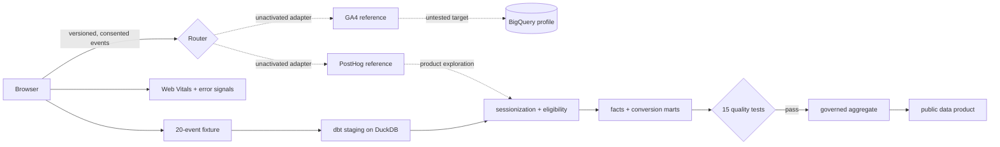

# Portfolio Intelligence Platform


**[Public dbt case study - no sign-in](https://kushpatel29.github.io/projects/portfolio-intelligence-platform/dist/case-study.html) · [Private owner dashboard](https://kushpatel29.github.io/projects/portfolio-intelligence-platform/dist/)**

A web analytics system with two explicit data paths. The private owner dashboard reads real portfolio visits, active section/project attention and approximate countries directly from the existing GoatCounter account, refreshing every 60 seconds. Its read-only credential stays in the owner's browser; no key or live visitor data is published. The separate public dbt case study uses a clearly labeled synthetic dataset. No demo value is presented as real visitor behavior.

See [live analytics setup, definitions and privacy boundaries](docs/live-analytics.md). Historical section time is unavailable: attention collection starts with this release. Visits are estimates rather than verified people; location is coarse country-level. The remaining sections document the synthetic case-study pipeline.

## Why this exists

Page-view counters do not answer the questions a hiring portfolio actually creates: Which work earns attention? Where do evaluators stop? Do technical visitors return? Is the site fast for real users? Can anyone trust the numbers?

This project treats those questions as a small analytics product, with collection, identity, modeling, semantics, reliability, privacy, and presentation designed together.

## Two-minute reviewer tour

1. Open the public case study and inspect the labelled four-day fixture, acquisition, funnel and project views. It requires no API key. The private owner dashboard has its own live date-range controls.
2. Open **Metrics** to switch among acquisition, engagement, conversion, retention, experience, and data-health families.
3. Inspect the explicit unavailable states for retention and Core Web Vitals—the fixture does not pretend to contain evidence it lacks.
4. Open **Lineage** to see definitions, grain, ownership, freshness, and source-to-mart paths.
5. Review **Quality** for the 15-test gate and the local-to-production architecture.

## Synthetic case-study architecture



The implemented path runs on DuckDB in the repository's root CI. GA4, PostHog, and BigQuery are clearly marked reference integration points: no provider ID is configured and no claim of provider experience is made.

## Modern measurement coverage

| Family | Governed measures |
|---|---|
| Acquisition | users, new users, sessions, sessions/user, channel share, campaign conversion |
| Engagement | engaged sessions/rate/time, views/session, scroll completion, project depth |
| Conversion | high intent, resume view/download, GitHub CTR, contact rate, funnel completion |
| Retention | definitions and honest unavailable states; four days is insufficient for W1/W4 cohorts |
| Experience | collectors and thresholds implemented; values unavailable because no RUM provider is active |
| Data health | contract/consent coverage, attribution coverage, duplicates, late arrivals, exclusions |

Exact formulas, grains, owners, exclusions, and service levels live in [`docs/metric-definitions.md`](docs/metric-definitions.md). The UI, documentation, and warehouse semantics use the same vocabulary.

## Credibility by design

- **Privacy boundary:** direct identifiers, free-form input, IP addresses, and query-string content are prohibited.
- **Consent first:** provider dispatch is disabled until analytics consent is granted.
- **Explicit identity:** pseudonymous visitor IDs and 30-minute inactivity sessions are first-party and versioned.
- **Honest demo:** `is_synthetic`, `is_internal`, bot, and automated-test flags preserve lineage while excluding ineligible rows.
- **Session-safe math:** conversions are deduplicated; period rates are recomputed from counts rather than averaged.
- **Performance as analytics:** LCP, INP, CLS, FCP, TTFB, and privacy-safe error categories share the event contract.
- **Controlled change:** breaking event or metric changes require versioning, migrations, tests, and owner review.

## Free-tier stack

| Layer | Tool | Reason |
|---|---|---|
| Collection | allowlisted browser dispatcher | implemented locally; GA4/PostHog hooks remain unactivated references |
| Performance | PerformanceObserver | native Web Vitals and error-health capture without a paid SDK |
| Warehouse | DuckDB implemented / BigQuery profile only | reproducible evidence without implying the cloud target has run |
| Transformation | dbt Core | documented SQL lineage, tests, modular models, adapter portability |
| Automation | root GitHub Actions workflow | rebuilds dbt, regenerates JSON, and rejects output drift |
| Data product | semantic HTML, CSS, vanilla JS | fast, accessible, dependency-light public experience |
| Hosting | GitHub Pages | HTTPS public code/UI; live data is read privately from GoatCounter |

No paid tool is required to review or run the project locally.

## Repository map

```text
analytics/       Consent-aware dispatcher and Web Vitals collection
dbt/             Seed, staging, sessions, facts, mart, macros, and tests
dist/            Deployed interactive analytics data product
docs/            Architecture, data model, event plan, metrics, and privacy
scripts/         Deterministic export from tested dbt relations to dashboard JSON
```

## Run it in under five minutes

Preview the data product:

```bash
python -m http.server 4173
```

Then open **`http://localhost:4173/dist/case-study.html`** for the public synthetic demo.
The separate owner connection screen is at `http://localhost:4173/dist/` and requires the owner’s read-only key.

Reproduce the analytics pipeline with the free DuckDB adapter:

```bash
python -m venv .venv
# Windows: .venv\Scripts\activate
# macOS/Linux: source .venv/bin/activate
pip install dbt-duckdb==1.9.2
dbt seed --project-dir dbt --profiles-dir dbt
dbt build --project-dir dbt --profiles-dir dbt
```

Expected gate: **PASS across 20 dbt nodes, including 15 data tests**. The suite covers uniqueness, nullability, accepted values, session ordering, conversion bounds, and business-rule integrity. Root CI then runs `scripts/export_dashboard.py` and fails if `dist/data/dashboard.json` changes.

## Data model and contract

```text
raw_events (committed deterministic seed)
  └─ stg_events            normalized and typed events
      └─ int_sessions      30-minute reconstruction + eligibility
          ├─ fct_sessions  one row per session
          └─ mart_conversion
```

The browser accepts only registered `snake_case` event names. Every payload adds a UUID, contract version, UTC timestamp, pseudonymous visitor ID, session ID, clean page path, consent state, and explicit internal/synthetic flags. See [`docs/event-tracking-plan.md`](docs/event-tracking-plan.md) and [`docs/data-model.md`](docs/data-model.md).

## Optional reference-provider activation

GoatCounter is the implemented live provider; its independent owner view does not use the fixture's session models. The optional GA4/PostHog adapters and BigQuery target below remain scaffolded. To activate those additional providers:

1. Create GA4 and PostHog projects and place only their public browser identifiers behind the consent manager.
2. Enable GA4’s BigQuery export in a dedicated raw dataset.
3. Configure least-privilege dbt credentials through environment secrets.
4. Validate internal, bot, test, and synthetic filters against known fixtures.
5. Replace the demo aggregate only after privacy review and a passing production build.
6. Add freshness and volume alerts before relying on the metrics operationally.

Never commit provider secrets or publish person-level event exports.

## Verification checklist

- [x] Interactive 30 / 90 / 365-day views
- [x] Six-family modern metric explorer
- [x] Core Web Vitals collectors and metric contracts
- [ ] Real p75 Web Vitals — unavailable until a consented RUM provider is activated
- [ ] Weekly retention cohorts — unavailable in a four-day fixture
- [x] Metric contracts and interactive lineage
- [x] Consent-aware allowlisted dispatcher with unactivated provider hooks
- [x] Reproducible DuckDB/dbt pipeline
- [x] Fifteen automated data tests
- [x] Responsive and keyboard-accessible interface
- [x] Clearly labeled synthetic public data
- [x] Production activation and privacy boundary documented

## Deliberate limitations

- The public dbt case study uses a fixed synthetic aggregate. The default owner dashboard instead requires a private read-only GoatCounter connection and never falls back to that fixture.
- GA4, PostHog, and BigQuery have never been run for this project. They are reference hooks and a profile, not evidence of hands-on provider use.
- DuckDB exercises the transformation contract; production-scale partitioning and clustering are BigQuery concerns documented in [`docs/architecture.md`](docs/architecture.md).
- The live collector is cookie-free, respects DNT/GPC and sends no form content or precise location. Its measurement limitations and owner-storage tradeoff are documented separately.

## License

Released under the [MIT License](LICENSE).
