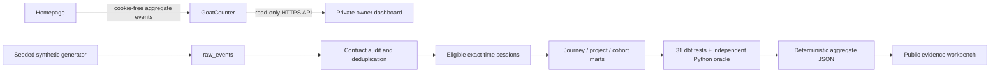

# Portfolio Intelligence Platform

[](https://github.com/KushPatel29/KushPatel29.github.io/actions/workflows/verify.yml)

**[Explore the public workbench](https://kushpatel29.github.io/projects/portfolio-intelligence-platform/dist/case-study.html) · [Open private live analytics](https://kushpatel29.github.io/projects/portfolio-intelligence-platform/dist/)**

Which work earns attention, and can the numbers be trusted? This project answers the first question with private real-traffic analytics and the second with a reproducible analytics engineering case. The two paths have separate data sources, identifiers and measurement contracts. Neither falls back to the other.

**[Plan and challenge an experiment](https://kushpatel29.github.io/projects/portfolio-intelligence-platform/dist/experiment.html)** — sample size, assignment quality, Wilson/Newcombe uncertainty and an error guardrail, checked independently against SciPy/statsmodels. Examples are wholly synthetic; no real A/B test or additional tracking is activated. [Method and verification](docs/experimentation.md).

| Path | Implemented behavior | Boundary |
|---|---|---|
| Private owner dashboard | Real homepage visits, sampled section/project attention, approximate countries, complete-day comparisons, daily tables and JSON/CSV exports | Read-only GoatCounter API; no visitor identities, individual funnels or retrospective dwell-time reconstruction |
| Public evidence workbench | Working 30/60/90-day filters, first-touch acquisition, ordered journeys, session-project engagement, weekly retention with censored cells, event accounting and provenance | All 1,460 delivered events are generated synthetic data, not portfolio visitors |

## Inspect it in two minutes

1. Open the public workbench without signing in. The full fixture produces **568 sessions from 1,441 eligible events**.
2. Switch from 90 to 30 days. Counts, sources, daily bars, project rates and the ordered journey change together.
3. Inspect an immature retention cell: it stays unavailable instead of becoming a misleading zero.
4. Open Quality & lineage: 12 duplicate deliveries, three invalid contracts and four consent/bot/internal/test exclusions reconcile to the source. The test-marker flag simulates an exclusion scenario; the entire dataset is synthetic regardless of that flag.
5. Read the [independent Python oracle](scripts/verify_warehouse.py), which checks every session, first touch, journey, session-project pair and cohort against the SQL output.

## What the upgrade fixed

- Landing pages and acquisition sources now come from the **chronological first event**, not alphabetical `min()`.
- Inactivity uses exact elapsed time: 29m59.999s stays in-session; exactly 30m starts another.
- A funnel stage requires the preceding stage in the same session, in order. Separate action totals cannot masquerade as a journey.
- Repeated project events are reduced to a session-project grain before rate calculation. Only later actions count as downstream association; no causal lift is claimed.
- Cohort denominators are fixed at first observed week. An incomplete calendar week is NULL, including when some activity is already observed.
- Live reads validate integer counts, pagination progress and daily reconciliation; retries are bounded and stale responses cannot overwrite a newer window.
- Comparisons use two equal **complete UTC-day** windows, separate from live headlines that include a partial today. Zero baselines have no percentage change.

## Reproduce the warehouse

Python 3.12 and Node 22 or newer. From this directory:

```bash
python -m venv .venv
# Activate .venv (Windows: .venv\Scripts\activate; macOS/Linux: source .venv/bin/activate)
pip install -r requirements.txt
python scripts/generate_fixture.py --check
dbt build --project-dir dbt --profiles-dir dbt
python scripts/verify_warehouse.py
python scripts/exercise_quality_gates.py
python scripts/export_dashboard.py
node scripts/check_public_contract.mjs
python -m http.server 4173
```

Open `http://localhost:4173/dist/case-study.html`. Expected build: **40 nodes including 31 data tests**, all passing. Eight SQL models and one seed produce committed deterministic aggregates; CI rejects export drift. Runtime versions are pinned in `requirements.txt`. To deliberately change the fixture, run `generate_fixture.py` without `--check`, then rebuild and review the differences.

From the repository root, `pnpm test:unit` checks API and collection behavior; `pnpm test:e2e` exercises both interfaces, privacy/storage choices, failure states, keyboard-accessible native controls and mobile layouts. The repository's verify workflow also rebuilds dbt and runs the independent oracle.

After editing browser assets, run `python scripts/stamp_assets.py --write` and review the fingerprint changes. CI checks the complete HTML/CSS/module dependency chain, so a cached parent cannot silently retain an old child module. Public aggregate fetches revalidate their data rather than using an unexpired older fixture.



## Live connection and reliability

Use the existing site-scoped **Read statistics** key, as described in [live analytics](docs/live-analytics.md). It travels only in the Authorization header to GoatCounter, not in URLs or this repository. Memory-only is the default; remembering the key is an explicit owner choice on a trusted browser. Disconnect clears the stored key and displayed data.

Requests are serialized below the provider's documented four-per-second limit. HTTP 429/5xx responses get at most two retries, with bounded delay. Individual requests have a 20-second timeout. Pagination is bounded at 20 pages and rejects repeated IDs. Failed refreshes retain visibly stale values only for the same selection; switching windows clears them. No real traffic is inserted to populate charts. Retrieval time is not a provider processing timestamp.

Daily chart labels follow the GoatCounter account timezone, while request and comparison boundaries use UTC. Country day buckets may not share hourly visit boundaries; the dashboard displays counts without inferring conversion rates or percentages from mismatched grains.

## Evidence and limits

[Validation record](docs/validation-report.md) · [Metric definitions](docs/metric-definitions.md) · [Data model](docs/data-model.md) · [Architecture/recovery](docs/architecture.md) · [Privacy/threat model](docs/privacy-design.md)

This is a personal analytics product, not evidence of enterprise traffic scale, paid adoption or statistically established conversion lift. Real retention, person-level paths and real-user p75 Web Vitals are unavailable. Unactivated GA4/PostHog/observer reference files under `analytics/` are not loaded by either dashboard. The experimental observer does not implement complete official INP/CLS algorithms. BigQuery is a future design option, not an executed target in this project. The public workbench itself performs no collection or visitor storage.

Released under the [MIT License](LICENSE).
